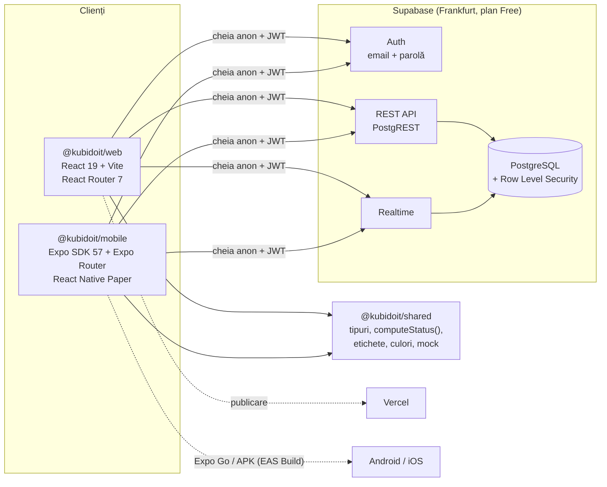
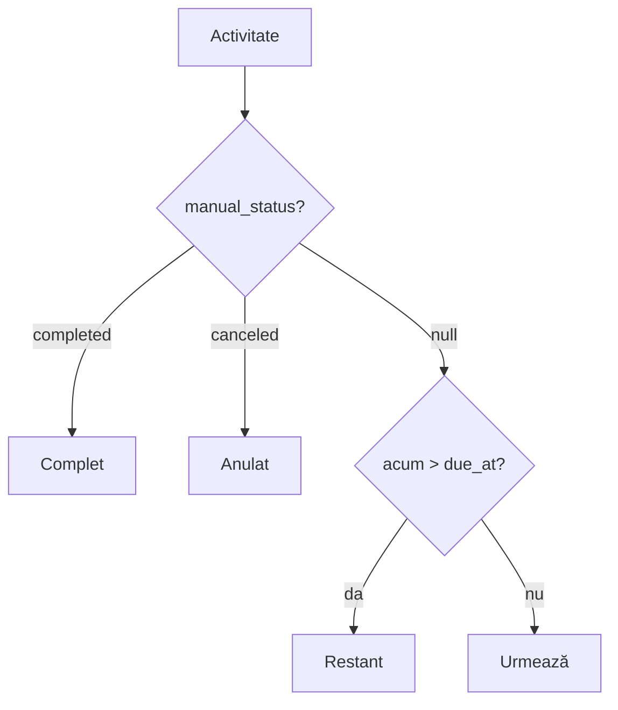

# Arhitectura KubiDoIt

Document de specificații pentru livrabilul L1. Responsabil: Pilat David (backend), revizuit de Nicolescu Andreas.

## Privire de ansamblu

KubiDoIt are două aplicații client, web și mobil, care folosesc același backend Supabase. Logica comună (tipuri, calculul statusului, etichete, culori) stă într-un singur pachet, `@kubidoit/shared`, importat de ambele aplicații.

## Pachetele din monorepo

Monorepo cu npm workspaces; `npm install` din rădăcină instalează tot.

| Pachet             | Folder      | Conținut                                                                                                                                                                          |
| ------------------ | ----------- | --------------------------------------------------------------------------------------------------------------------------------------------------------------------------------- |
| `@kubidoit/shared` | `shared/`   | TypeScript pur, fără React și fără API-uri DOM / React Native. Fără pas de build: aplicațiile importă direct sursa (`src/index.ts`). Testele Vitest stau lângă cod (`*.test.ts`). |
| `@kubidoit/web`    | `web/`      | Vite, React 19, React Router 7. Pagini: Login, Tasks, Stats. Clientul Supabase: `src/lib/supabase.ts`.                                                                            |
| `@kubidoit/mobile` | `mobile/`   | Expo SDK 57, Expo Router (ecranele în `app/`), React Native Paper. Tab-uri: Activități, Statistici, Profil. Clientul Supabase: `lib/supabase.ts`.                                 |
| –                  | `supabase/` | `config.toml` și migrațiile SQL, aplicate în ordinea numelor.                                                                                                                     |

Reguli:

- Logica folosită de ambele aplicații se scrie **o singură dată**, în `shared/`.
- `shared/` nu importă React: hook-urile și componentele rămân în fiecare aplicație.
- Web și mobil folosesc **aceeași versiune de React** (19.2.3, cea fixată de Expo SDK 57). Dacă o aplicație ar avea altă versiune, npm ar instala două copii de React.

## Logica statusurilor (R3)

- Implementată o singură dată: `computeStatus(task, now)` în `shared/src/status.ts`, acoperită de teste.
- În baza de date se salvează doar statusul manual (`completed` / `canceled`). **Restant** și **Urmează** se calculează mereu în client, pentru că se schimbă odată cu trecerea timpului.
- Aplicațiile recalculează statusurile periodic (de exemplu la 30 de secunde), ca o activitate să devină „Restant” fără reîncărcarea paginii.

## Fluxul datelor

1. **Mod demo (acum):** fără `.env`, aplicațiile pornesc cu date mock din `shared/` și păstrează modificările doar în memorie.
2. **Cu Supabase (de la M3):**
   - utilizatorul se autentifică prin Supabase Auth (email + parolă), iar sesiunea se păstrează local (`localStorage` pe web, `expo-sqlite/localStorage` pe mobil);
   - citirile și scrierile merg prin REST API cu JWT-ul utilizatorului, iar RLS limitează fiecare cerere la datele lui;
   - funcțiile de acces la date (listare, creare, ștergere, schimbare status) stau în `shared/src/api/` și primesc clientul Supabase ca parametru, ca să nu fie scrise de două ori;
   - pentru sincronizare (R5, O4 ≤ 5 s), fiecare aplicație se abonează la `postgres_changes` pe tabelul `tasks` și își reîmprospătează lista la fiecare eveniment.

## Securitate

- În aplicații ajunge doar cheia **anon / publishable**. E publică prin natura ei; datele sunt protejate de **Row Level Security**.
- Cheia **service_role / secret** nu se folosește în aplicații și nu apare în niciun fișier din repository.
- Toate tabelele au RLS activat; politicile sunt descrise în [schema-bd.md](schema-bd.md).
- Rolul `anon` nu are drepturi pe tabele: fără autentificare nu se poate citi nimic.
- Fișierele `.env` sunt în `.gitignore`; fiecare membru le creează din `.env.example`.

## Variabile de mediu

| Aplicație | Fișier        | Variabile                                                   |
| --------- | ------------- | ----------------------------------------------------------- |
| Web       | `web/.env`    | `VITE_SUPABASE_URL`, `VITE_SUPABASE_ANON_KEY`               |
| Mobil     | `mobile/.env` | `EXPO_PUBLIC_SUPABASE_URL`, `EXPO_PUBLIC_SUPABASE_ANON_KEY` |

Pe Vercel, variabilele web se setează în _Project Settings → Environment Variables_.

## Calitate și integrare continuă

- `npm run lint` (ESLint, o singură configurație pentru tot monorepo-ul), `npm run typecheck` (TypeScript în fiecare pachet), `npm test` (Vitest), `npm run format` (Prettier).
- GitHub Actions (`.github/workflows/ci.yml`) rulează pe fiecare Pull Request: lint, verificarea formatării, typecheck, teste și build-ul web.

## Publicare

- **Web:** Vercel, cu _Root Directory_ `web/`. `web/vercel.json` trimite toate rutele la `index.html` (rutare în client).
- **Mobil:** Expo Go pentru testare; APK Android prin EAS Build (profil `preview`, `buildType: apk`). Publicarea în magazine nu face parte din proiect.
