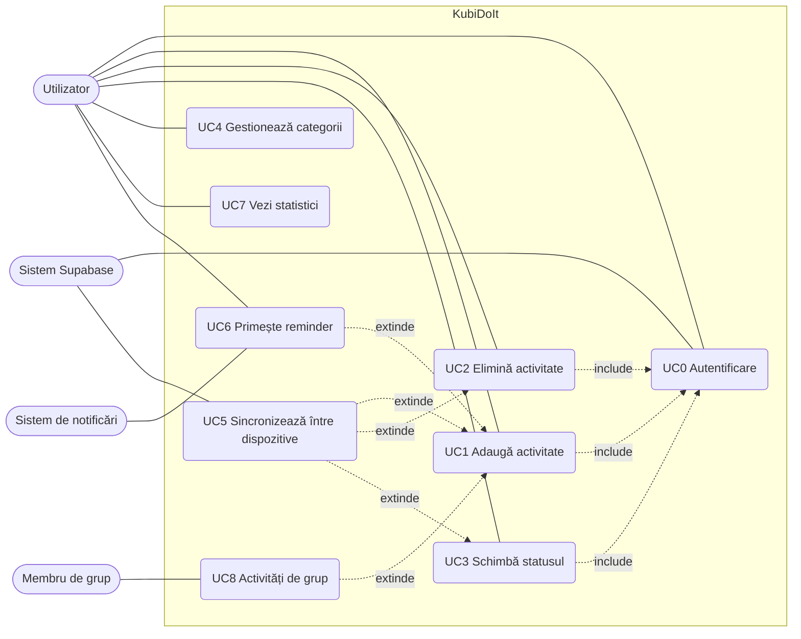

# Cazuri de utilizare

Document de specificații pentru livrabilul L1. Responsabil: Nicolescu Andreas. Cerințele (R1–R8) vin din [Project Charter](project-charter/Schita_ProjectCharter.md), iar regulile de date din [schema-bd.md](schema-bd.md).

## Actori

| Actor                | Descriere                                                                                         |
| -------------------- | ------------------------------------------------------------------------------------------------- |
| Utilizator           | Persoana care își gestionează activitățile pe web sau pe mobil. Trebuie să fie autentificat (R5). |
| Membru de grup       | Utilizator care face parte dintr-un grup (R8, opțional).                                          |
| Sistem (Supabase)    | Auth, API, Realtime, RLS. Nu are interfață, dar execută regulile de securitate și sincronizare.   |
| Sistem de notificări | Notificări în browser (web) și notificări locale `expo-notifications` (mobil).                    |

## Diagrama cazurilor de utilizare

## Corespondența cu cerințele

| Caz | Cerință | Prioritate   |
| --- | ------- | ------------ |
| UC0 | R5      | Obligatoriu  |
| UC1 | R1      | Minim (temă) |
| UC2 | R2      | Minim (temă) |
| UC3 | R3      | Minim (temă) |
| UC4 | R4      | Obligatoriu  |
| UC5 | R5, O4  | Obligatoriu  |
| UC6 | R6      | Obligatoriu  |
| UC7 | R7      | Important    |
| UC8 | R8      | Opțional     |

## UC0 – Autentificare (R5)

- **Actor:** Utilizator. **Precondiții:** are un cont sau își creează unul.
- **Flux principal:**
  1. Utilizatorul deschide aplicația fără sesiune și este dus la ecranul Login.
  2. Introduce email și parolă și apasă „Autentificare”.
  3. Supabase Auth validează datele și creează sesiunea.
  4. Aplicația deschide lista de activități.
- **Alternative:**
  - Cont nou: „Înregistrare” cu email + parolă, apoi pasul 4.
  - Date greșite: se afișează un mesaj de eroare, iar utilizatorul rămâne pe Login.
  - Logout: sesiunea se șterge, iar utilizatorul revine la Login.
  - Fără configurare Supabase (`.env` lipsă): aplicația rulează în mod demo, fără autentificare.
- **Postcondiții:** sesiunea rămâne după reîncărcarea paginii / repornirea aplicației. Fără sesiune, `/tasks` duce la `/login`.

## UC1 – Adaugă activitate (R1)

- **Actor:** Utilizator. **Precondiții:** este autentificat.
- **Flux principal:**
  1. Utilizatorul deschide formularul „Activitate nouă”.
  2. Completează titlul și termenul (data și ora), opțional descrierea, categoria și „Critic”.
  3. Apasă „Adaugă”.
  4. Aplicația validează datele și salvează activitatea.
  5. Activitatea apare în listă, cu statusul **Urmează** (sau **Restant**, dacă termenul a trecut deja).
- **Alternative:**
  - Titlu gol sau doar spații, sau mai lung de 200 de caractere: eroare lângă câmp, nu se salvează.
  - Descriere peste 2000 de caractere: eroare lângă câmp.
  - Termen lipsă: eroare lângă câmp.
  - Eroare de rețea: mesaj de eroare, datele din formular se păstrează.
- **Postcondiții:** activitatea aparține utilizatorului (`user_id = auth.uid()`) și e vizibilă doar lui.

## UC2 – Elimină activitate (R2)

- **Actor:** Utilizator. **Precondiții:** există cel puțin o activitate.
- **Flux principal:**
  1. Utilizatorul apasă „Șterge” pe o activitate.
  2. Aplicația cere confirmare (dialog cu textul comun din `shared/`).
  3. Utilizatorul confirmă.
  4. Activitatea dispare din listă și din baza de date.
- **Alternative:** „Anulează” în dialog: activitatea rămâne neschimbată.
- **Postcondiții:** celelalte dispozitive nu mai afișează activitatea (UC5). Un utilizator nu poate șterge activitățile altuia (RLS).

## UC3 – Schimbă statusul (R3)

- **Actor:** Utilizator. **Precondiții:** există o activitate.
- **Regulile statusului** (`computeStatus(task, now)`):

| `manual_status` | Termenul       | Status afișat |
| --------------- | -------------- | ------------- |
| `completed`     | oricare        | Complet       |
| `canceled`      | oricare        | Anulat        |
| nul             | `now > due_at` | Restant       |
| nul             | `now ≤ due_at` | Urmează       |

- **Flux principal:**
  1. Utilizatorul apasă „Complet” sau „Anulat” pe o activitate.
  2. Aplicația salvează `manual_status`.
  3. Statusul și culoarea se actualizează în listă.
- **Alternative:**
  - „Reactivează” pe o activitate Completă / Anulată: `manual_status` devine nul, iar statusul se recalculează după termen.
  - Termenul trece cât timp aplicația e deschisă: activitatea devine **Restant** fără reîncărcare (recalculare la ~30 s).
- **Postcondiții:** la finalizare, `completed_at` primește momentul curent (trigger); la anulare sau reactivare devine nul. Restant / Urmează nu se salvează niciodată.

## UC4 – Gestionează categorii (R4)

- **Actor:** Utilizator. **Precondiții:** este autentificat.
- **Flux principal:**
  1. La crearea sau editarea unei activități, utilizatorul alege o categorie (predefinite: Muncă, Școală, Sală).
  2. Lista afișează eticheta categoriei.
  3. Utilizatorul filtrează lista după o categorie sau o grupează pe categorii.
- **Alternative:**
  - Creează o categorie personalizată (nume 1–40 de caractere, culoare `#RRGGBB`, nume unic per utilizator).
  - Șterge o categorie personalizată: activitățile ei rămân fără categorie.
  - Categoriile predefinite nu pot fi modificate sau șterse.
- **Postcondiții:** categoriile personalizate sunt vizibile doar creatorului.

## UC5 – Sincronizează între dispozitive (R5)

- **Actor:** Utilizator, Sistem (Supabase). **Precondiții:** utilizatorul e autentificat cu același cont pe două dispozitive.
- **Flux principal:**
  1. Pe dispozitivul A utilizatorul adaugă, șterge sau modifică o activitate (UC1–UC3).
  2. Supabase Realtime trimite evenimentul `postgres_changes` către dispozitivul B.
  3. Dispozitivul B își reîmprospătează lista.
- **Criteriu de succes (O4):** modificarea apare pe celălalt dispozitiv în cel mult **5 secunde**, în ambele sensuri (web → mobil și mobil → web).
- **Alternative:** la ștergere, evenimentul conține doar cheia primară; clientul elimină activitatea după `id` sau reîncarcă lista. Pe mobil, tragerea listei în jos (pull-to-refresh) reîncarcă datele manual.

## UC6 – Primește reminder (R6)

- **Actor:** Utilizator, Sistem de notificări. **Precondiții:** activitatea are „Critic” activat și nu e Completă / Anulată.
- **Flux principal:**
  1. Utilizatorul marchează activitatea „Critic”.
  2. Aplicația cere permisiunea pentru notificări (prima dată).
  3. Aplicația calculează momentul reminderului, înainte de termen.
  4. La acel moment apare notificarea.
- **Alternative:**
  - Permisiune refuzată: activitatea rămâne „Critic”, dar nu apare notificare; aplicația explică de ce.
  - Activitatea e editată, finalizată sau ștearsă: reminderul se reprogramează sau se anulează.
  - Web: notificarea apare doar cât timp aplicația e deschisă. Mobil: notificare locală programată, care apare și cu aplicația închisă.

## UC7 – Vezi statistici (R7)

- **Actor:** Utilizator. **Precondiții:** este autentificat.
- **Flux principal:**
  1. Utilizatorul deschide pagina / tab-ul Statistici.
  2. Aplicația afișează numărul de activități finalizate azi și în săptămâna aceasta, procentul de finalizare și culorile după status.
- **Alternative:** fără activități, se afișează o stare goală, nu valori de tip „NaN%”.
- **Cazuri limită:** miezul nopții, începutul săptămânii, schimbarea orei (vezi planul de testare).

## UC8 – Activități de grup (R8, opțional)

- **Actor:** Utilizator, Membru de grup. **Precondiții:** R8 e inclus în scope (decizie PM + echipă).
- **Flux principal:**
  1. Utilizatorul creează un grup și primește un cod de invitație.
  2. Alt utilizator intră în grup cu codul (`join_group(invite_code)`).
  3. Un membru adaugă o activitate de grup.
  4. Toți membrii grupului o văd și o pot edita.
- **Alternative:** un utilizator care nu e membru nu vede activitățile grupului (RLS); cod invalid: mesaj de eroare; un membru poate părăsi grupul.
- **Stare:** dacă R8 iese din scope, acest caz rămâne documentat, dar nu se implementează.
