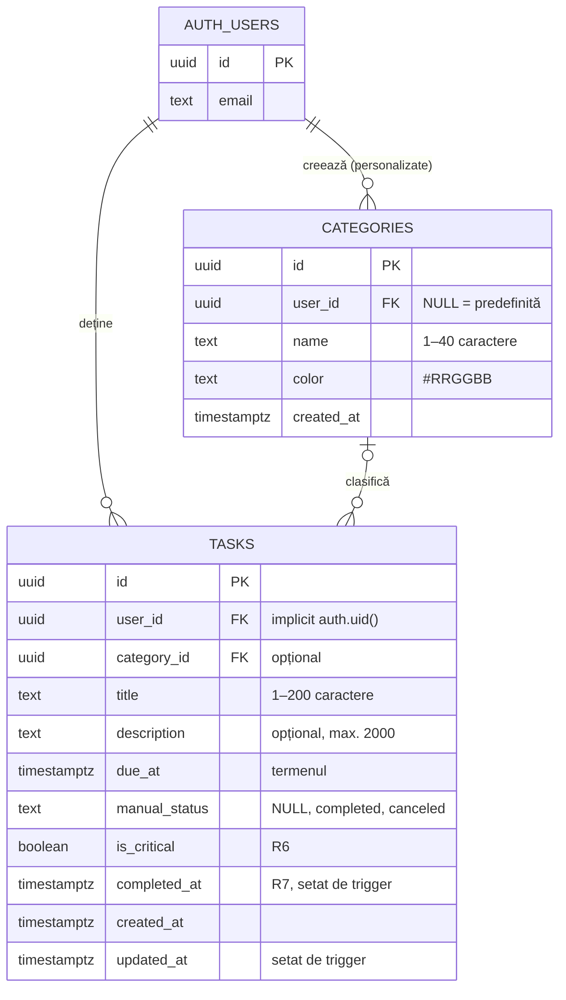

# Schema bazei de date

Document de specificații pentru livrabilul L1. Responsabil: Pilat David.
Sursa de adevăr este migrația [`supabase/migrations/20261014120000_init_schema.sql`](../supabase/migrations/20261014120000_init_schema.sql); documentul o explică.

## Diagrama entitate–relație



`auth.users` este tabelul gestionat de Supabase Auth.

## Tabele

### `public.categories` (R4)

| Coloană      | Tip           | Reguli                                                                      |
| ------------ | ------------- | --------------------------------------------------------------------------- |
| `id`         | `uuid`        | cheie primară, `gen_random_uuid()`                                          |
| `user_id`    | `uuid`        | `NULL` = categorie predefinită; altfel proprietarul (implicit `auth.uid()`) |
| `name`       | `text`        | 1–40 caractere, unic per utilizator (`unique nulls not distinct`)           |
| `color`      | `text`        | opțional, format `#RRGGBB`                                                  |
| `created_at` | `timestamptz` | `now()`                                                                     |

Categoriile predefinite sunt create de migrație, cu ID-uri fixe: **Muncă** (`…0001`), **Școală** (`…0002`), **Sală** (`…0003`).

### `public.tasks` (R1–R3, R6, R7)

| Coloană         | Tip           | Reguli                                                                     |
| --------------- | ------------- | -------------------------------------------------------------------------- |
| `id`            | `uuid`        | cheie primară                                                              |
| `user_id`       | `uuid`        | obligatoriu, implicit `auth.uid()`; ștergerea contului șterge activitățile |
| `category_id`   | `uuid`        | opțional; ștergerea categoriei lasă activitatea fără categorie             |
| `title`         | `text`        | 1–200 caractere (fără spațiile de la capete)                               |
| `description`   | `text`        | opțional, max. 2000 caractere                                              |
| `due_at`        | `timestamptz` | obligatoriu; termenul folosit de `computeStatus()`                         |
| `manual_status` | `text`        | `NULL`, `'completed'` sau `'canceled'`                                     |
| `is_critical`   | `boolean`     | implicit `false`; activitate „Critic”, primește reminder (R6)              |
| `completed_at`  | `timestamptz` | momentul finalizării, pentru statistici pe zi / săptămână (R7)             |
| `created_at`    | `timestamptz` | `now()`                                                                    |
| `updated_at`    | `timestamptz` | actualizat automat                                                         |

Indecși: `(user_id, due_at)` pentru lista sortată după termen, `category_id` pentru filtrare.

**De ce nu există coloana `status`:** Restant / Urmează depind de ora curentă, deci o valoare salvată ar deveni greșită fără nicio scriere. Se salvează doar statusul manual; statusul afișat îl calculează `computeStatus()` din `@kubidoit/shared`.

## Trigger `tasks_before_write`

Rulează înainte de fiecare `INSERT` / `UPDATE` pe `tasks`:

- `updated_at` primește `now()`;
- dacă `manual_status` devine `completed`, `completed_at` primește `now()` (se păstrează la actualizările ulterioare);
- dacă activitatea nu mai e `completed` (anulată sau reactivată), `completed_at` devine `NULL`.

Funcția are `search_path` gol, ca să nu poată fi păcălită cu obiecte din alte scheme.

## Securitate: drepturi și Row Level Security

- Rolul `anon` nu are niciun drept pe tabele. Rolul `authenticated` are doar `SELECT`, `INSERT`, `UPDATE` și `DELETE`.
- RLS este activat pe ambele tabele. Politicile folosesc `(select auth.uid())`, varianta recomandată de Supabase pentru performanță.

| Tabel        | Operație                 | Cine are voie                                                                                 |
| ------------ | ------------------------ | --------------------------------------------------------------------------------------------- |
| `categories` | SELECT                   | categoriile predefinite + ale utilizatorului                                                  |
| `categories` | INSERT / UPDATE / DELETE | doar ale utilizatorului (cele predefinite nu pot fi modificate)                               |
| `tasks`      | SELECT / DELETE          | doar activitățile proprii                                                                     |
| `tasks`      | INSERT / UPDATE          | doar activități proprii, iar `category_id` trebuie să fie o categorie vizibilă utilizatorului |

Verificarea categoriei este necesară pentru că cheile străine ignoră RLS: fără ea, cineva ar putea lega o activitate de categoria personală a altui utilizator.

## Realtime (R5)

Tabelul `tasks` este adăugat în publicația `supabase_realtime`. Clienții se abonează la `postgres_changes`, iar RLS se aplică și evenimentelor: fiecare utilizator primește doar modificările activităților lui. La `DELETE`, Supabase trimite doar cheia primară (rândul nu mai există), deci clientul elimină activitatea după `id` sau reîncarcă lista.

## Aplicarea migrației

În ordinea numelor fișierelor, prin una dintre metode:

- **SQL Editor:** _SQL Editor → New query_, lipești conținutul fișierului, _Run_;
- **Supabase CLI:** `npx supabase login`, `npx supabase link --project-ref <id-proiect>`, `npx supabase db push --remote`.

Din Supabase CLI 3, comenzile `db` și `gen` țintesc implicit baza locală din Docker; `--remote` le trimite la proiectul legat.

După aplicare, tipurile TypeScript se generează cu (în Git Bash; în PowerShell 5, `>` poate scrie fișierul în UTF-16):

```bash
npx supabase gen types --remote > shared/src/database.types.ts
```

## Testul RLS

Testul este în [`supabase/tests/rls_tasks.sql`](../supabase/tests/rls_tasks.sql). Își creează singur doi utilizatori, A și B, acționează pe rând ca fiecare dintre ei și ca `anon`, iar la final face `rollback`, deci în bază nu rămâne nimic. Fiecare verificare este un `assert`: dacă una pică, rularea se oprește cu mesajul ei.

Se rulează după fiecare migrație care schimbă politicile, prin una dintre metode:

- **SQL Editor:** lipești tot fișierul și apeși _Run_. Toate verificările trec dacă apare „Success. No rows returned”.
- **Supabase CLI:** `npx supabase db query --remote -f supabase/tests/rls_tasks.sql`. Toate verificările trec dacă comanda se termină fără eroare.

Nu este un test pgTAP, deci nu se rulează cu `supabase test db`.

### Ce verifică

| Cine                      | Verificare                                                                                          |
| ------------------------- | --------------------------------------------------------------------------------------------------- |
| A                         | își creează o activitate și o vede; `user_id` se completează singur din `auth.uid()`                |
| A                         | nu poate crea o activitate pe numele lui B și nici o categorie predefinită                          |
| B                         | nu vede activitatea lui A; UPDATE și DELETE pe ea ating 0 rânduri                                   |
| B                         | vede doar cele 3 categorii predefinite și nu le poate modifica sau șterge                           |
| A, după încercările lui B | activitatea e neatinsă; nu vede categoria personală a lui B                                         |
| A                         | poate folosi o categorie predefinită, dar nu pe cea a lui B (cheia străină ignoră RLS, politica nu) |
| B                         | își poate redenumi propria categorie (verificare pozitivă: RLS nu blochează tot)                    |
| A                         | nu poate modifica, șterge sau crea pe numele lui B o categorie a lui B                              |
| `anon`                    | `permission denied` la citirea din `tasks` și din `categories`                                      |

### Rezultate

| Data       | Proiect                        | Migrații                                                              | Rezultat                                                               |
| ---------- | ------------------------------ | --------------------------------------------------------------------- | ---------------------------------------------------------------------- |
| 03.11.2026 | KubiDoIt (cloud, eu-central-1) | `20261014120000_init_schema`                                          | toate verificările au trecut                                           |
| 19.11.2026 | KubiDoIt (cloud, eu-central-1) | `20261014120000_init_schema`, `20261119120000_revoke_rls_auto_enable` | toate verificările au trecut, inclusiv cele noi pentru categorii (#38) |

Ca verificare a testului însuși, o variantă cu o așteptare greșită intenționat (B vede 99 de activități) a picat cu mesajul `B vede activitatea lui A`, deci `assert`-urile sunt active. După ambele rulări, baza a rămas fără utilizatori de test și fără activități.

## Security Advisor și Performance Advisor

Verificate la 19.11.2026 (#38), după _Rerun linter_ în Dashboard → Advisors.

| Advisor     | Rezultat                                                                                    | Decizie                                                                                                                                                                                                                    |
| ----------- | ------------------------------------------------------------------------------------------- | -------------------------------------------------------------------------------------------------------------------------------------------------------------------------------------------------------------------------- |
| Security    | `public.rls_auto_enable()` (SECURITY DEFINER) putea fi apelată de `anon` și `authenticated` | Funcția e creată de Supabase pentru event trigger-ul `ensure_rls`, care activează RLS pe tabelele noi. Migrația `20261119120000_revoke_rls_auto_enable` scoate dreptul de execuție; trigger-ul funcționează în continuare. |
| Security    | Leaked Password Protection Disabled                                                         | Acceptat: verificarea parolelor compromise e disponibilă doar pe planul Pro.                                                                                                                                               |
| Performance | Unused Index pe `categories` și `tasks` (3 sugestii)                                        | Păstrați: indecșii pe `user_id` și `category_id` sunt cei recomandați pentru politicile RLS și apar nefolosiți doar pentru că baza are încă puține date.                                                                   |

## Migrațiile aplicate

În ordinea în care se aplică:

| Fișier                                      | Conținut                                                                    |
| ------------------------------------------- | --------------------------------------------------------------------------- |
| `20261014120000_init_schema.sql`            | tabelele `categories` și `tasks`, trigger-ul, drepturile, RLS, Realtime     |
| `20261119120000_revoke_rls_auto_enable.sql` | scoate dreptul de execuție pe `public.rls_auto_enable()` (Security Advisor) |

## Extensia pentru grupuri (R8, migrația 2)

Planificată pentru M5, dacă R8 rămâne în scope:

- `profiles` (`id` = `auth.users.id`, `display_name`, `email`), completat de un trigger la crearea contului;
- `groups` (`id`, `name`, `owner_id`, `invite_code` unic);
- `group_members` (`group_id`, `user_id`, `role`: `owner` / `member`; cheie primară compusă);
- `tasks.group_id` (opțional): activitate personală sau de grup;
- funcția `is_group_member(group_id)` cu `security definer`, folosită în politici (evită recursivitatea RLS pe `group_members`);
- funcția RPC `join_group(invite_code)`, prin care un utilizator intră în grup cu codul de invitație;
- politicile pentru `tasks` se extind: o activitate e vizibilă dacă e proprie **sau** dacă `group_id` aparține unui grup din care utilizatorul face parte.
